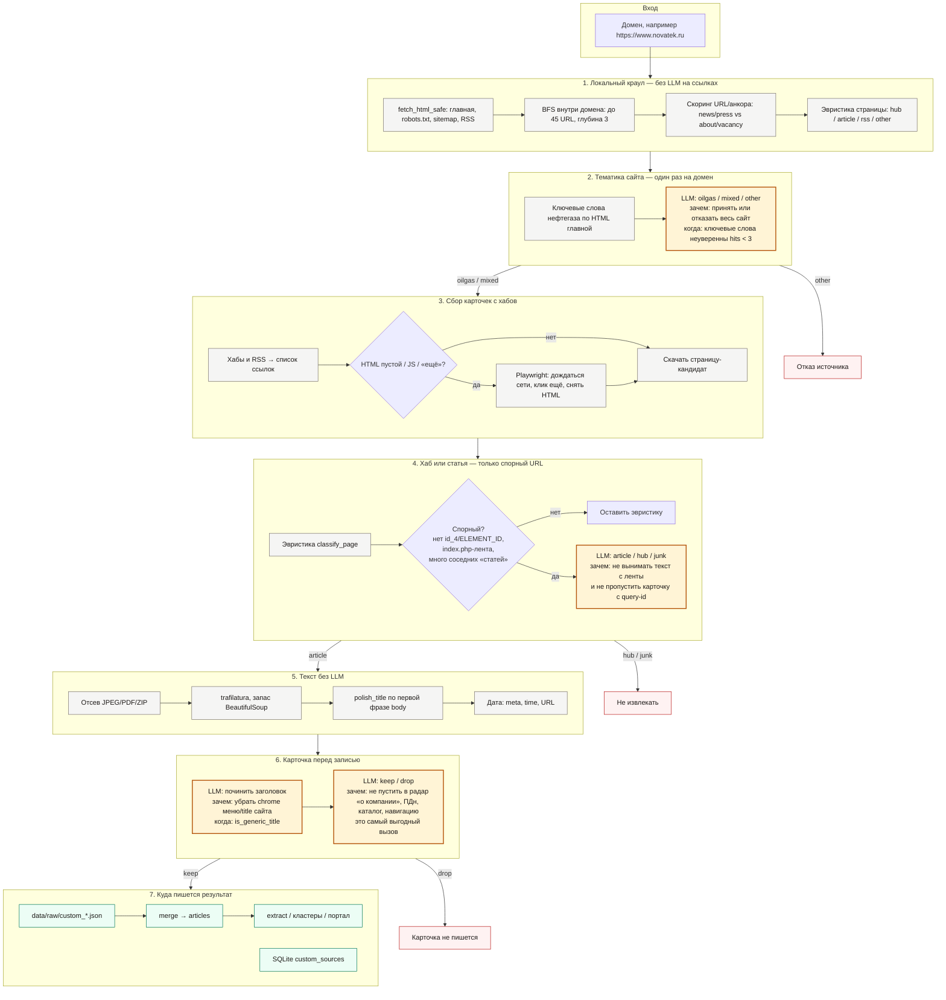
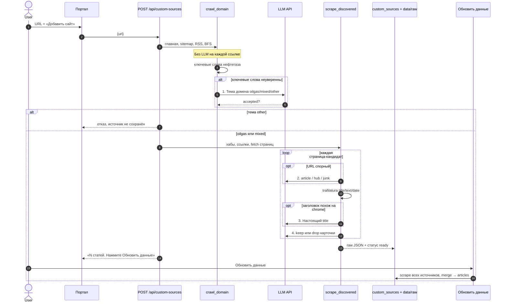
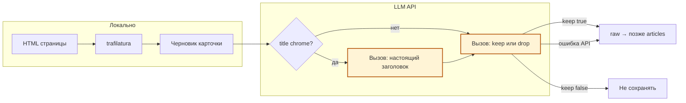

# Парсер пользовательских источников OilTech Radar 3.2

Этот текст описывает **фактически работающий** контур: как из адреса верхнего уровня (`https://www.novatek.ru`) получаются карточки радара `{title, text, datatime, source, link}`. Сайт обходится локально, текст статьи вынимается из HTML, а языковая модель вызывается только в четырёх узких местах.

Код живёт в `gartner/custom_sources/`. Точки входа одни и те же: кнопка «Добавить сайт» в настройке потока, кнопка «Обновить данные» для уже сохранённых источников и экспериментальный прогон `scripts/scrape_sample_15.py`.

---

## Идея контура

На корпоративных сайтах нефтегаза разметка разная, часто Bitrix с `?id_4=` / `ELEMENT_ID=`, иногда QRATOR и почти пустой HTML до cookies. Селекторы, подобранные один раз по главной, на следующей странице легко разъезжаются. При этом **текст новости в HTML уже есть** — ломается не извлекатель абзацев, а решение «это вообще новость?» и заголовок из `<title>` / меню («Пресс-релизы и мероприятия», «Новости | Компания»).

Контур сначала **находит URL ленты и карточек правилами**, затем **достаёт текст библиотекой**, и только потом спрашивает модель там, где эвристика врёт дорого: принять или выкинуть карточку, отличить ленту от статьи на спорном адресе, починить chrome-заголовок, один раз решить нефтегаз это или нет.

Скрин страницы и VLM в этом контуре **не используются**. Playwright, если нужен, снимает HTML, не картинку.

---

## Картина целиком

Жёлтые блоки — единственные места, где уходит запрос в LLM API (`LLMClient.json_call`, модель из `.env`, сейчас `gpt-6-astra`). Серые — локальный код без модели.

Четыре жёлтых узла — единственные обращения к модели. Обход, скоринг, trafilatura и merge модель не трогают.

---

## Как запускается контур

Когда в «Настройке потока» нажимают «Добавить сайт», браузер шлёт `POST /api/custom-sources`. Сервер создаёт `LLMClient` и вызывает `add_custom_source`. Запрос **синхронный**: кнопка ждёт, пока сайт обойдут и вынут пробные статьи (до 8 штук). Если домен уже есть, главная не открылась, тематика не нефтегаз или после гейтов не осталось ни одной карточки — источник в список не попадает.

«Обновить данные» идёт другим путём: пайплайн вызывает `scrape_all_custom_sources` по всем включённым источникам (до 40 статей на сайт), затем `merge_and_upsert` складывает `data/raw` в таблицу `articles`. Только после merge карточки видны в радаре и по кнопке «Статьи парсера». Само «Добавить сайт» пишет raw-файл и строку в `custom_sources`, но **ещё не** кладёт записи в `articles`.

На схеме LLM появляется четыре раза, с номерами как в коде: тема → вид страницы → заголовок → keep/drop. Дальше разобрано, что именно уходит в модель и что считается «спорным».

---

## Шаг 1. Локальный краул

`crawl_domain` в `crawl.py` нормализует стартовый URL и качает главную через `fetch_html_safe` (таймаут, повтор при TLS-странностях, распознавание JS-cookie challenge вроде QRATOR). Из главной и `robots.txt` собираются семена: объявленные sitemap, ссылки на RSS/Atom, типичные пути `/sitemap.xml`, `/rss`, `/press`, `/news`.

Очередь BFS ходит только по **тому же домену** (`same_site`, `www` не считается другим сайтом, а зеркало `.com` — считается). Лимит: **45 адресов**, **глубина 3**. Служебные пути (вакансии, контакты, about, cookie, shop) получают отрицательный `news_score` и в очередь почти не попадают.

Каждая скачанная страница классифицируется **без модели**:

если в теле RSS/Atom — это лента элементов; если URL похож на статью (`looks_like_article_url`: глубокий путь, `/news/slug`, или query `id_4` / `ELEMENT_ID` / `news_id`) и на странице мало соседних «статейных» ссылок — это статья; если соседних ссылок много или путь сам похож на `/press`, `/news` без id — это хаб.

Именно поэтому у НОВАТЭКа страница `index.php?id_4=7882` эвристически может выглядеть хабом: на ней куча ссылок на другие релизы. Это позже чинится правилом «query-id — карточка» и, при необходимости, LLM на **других** спорных адресах. Во время BFS модель **не вызывается**: иначе 45 страниц съели бы бюджет до выемки текста.

Результат краула — JSON-профиль источника: домен, тема, защита (`js_cookie`, timeout, 403), список хабов, кандидаты-статьи, элементы RSS, флаг «нужен браузер». Он кладётся в `custom_sources.rules_json` с `engine: crawl_trafilatura`.

---

## Шаг 2. Нефтегаз один раз на домен

После обхода берётся HTML главной и считается `classify_theme`: сколько нефтегазовых словоформ попало в видимый текст (нефть, скважина, СПГ, Лукойл, НОВАТЭК, petroleum…). Три и больше совпадений — `oilgas`, одно-два — `mixed`, ноль — `other`. Витрина с «корзиной» при слабых хитах тоже брак.

Если домен сам содержит `neft`, `gaz`, `oil`, `petro`, `lukoil`, `novatek`, отказ по ключевым словам переигрывается: сайт всё равно принимается. Это спасает корпоративные главные, где мало слов «скважина», но имя компании в хосте.

**Вызов LLM №1** (`refine_theme_once` → `classify_theme_llm`) бывает **не больше одного на домен** и только если ключевые слова не дали уверенный `oilgas` (меньше трёх хитов). В модель уходит домен, URL и обрезки HTML (~8 тыс. символов). Ответ: `oilgas` / `mixed` / `other`. `other` без токена нефтегаза в домене — источник отклоняется целиком, карточки не качаются. Если модель сказала «не нефтегаз», а в хосте всё же `neft`/`gaz`/…, код оставляет `oilgas` с пометкой `llm+domain`.

Так дешевле и честнее судить сайт, чем каждую ссылку. На прогоне тестовых доменов этот вызов реально сработал, например, на npnh.ru, где словарных хитов было мало.

---

## Шаг 3. Сбор ссылок и выемка HTML

`scrape_discovered` берёт RSS-элементы и `article_candidates` из профиля, затем обходит хабы. С хаба собираются ссылки с положительным news-score и «статейным» видом URL. Если у хаба есть `rel=next` / «далее», подгружаются ещё до трёх страниц, пока набор ссылок растёт.

Если краул пометил `needs_browser` (мало текста при куче `<script>`, cookie-challenge, кнопка «ещё»), и установлен Playwright, страница открывается в браузере, сеть дожидается, HTML снимается уже после JS. Это не классификация и не VLM: браузер здесь только транспорт.

Дальше по каждой ссылке (пока не набрано 8 статей при добавлении сайта или 40 при еженедельном scrape): проверка того же сайта, fetch, решение «это статья?», извлечение, гейты.

---

## Шаг 4. Хаб против статьи на спорном URL

Сначала снова эвристика `classify_page`. Если вид однозначный, модель молчит. **Вызов LLM №2** (`classify_kind_llm`) только если `is_ambiguous_kind`.

Спорным считается адрес **без** article-query (`id_4`, `ELEMENT_ID`, `news_id` и т.п.), когда сигналы конфликтуют: путь и про ленту, и про статью; `index.php` без id, который эвристика назвала статьёй; страница, похожая на статью, но с четырьмя и более соседними «статейными» ссылками (часто это как раз листинг); эвристика `other`, но news-score положительный.

В модель уходят URL, вердикт эвристики, число соседних ссылок и текстовый excerpt (~2500 символов без script/style). Ответ: `article`, `hub` или `junk` (junk сводится к `other`). Бюджет — **8 таких вызовов на домен**. Если лимит исчерпан, остаётся эвристика.

Жёсткое правило поверх модели: URL с `id_4` / `ELEMENT_ID` **не отдаётся** в этот гейт и не может быть переименован в хаб. Иначе НОВАТЭК обнуляется: карточка релиза обрастает ссылками на соседние релизы, модель говорит «лента», текст не извлекается. После этого правила тестовый прогон снова дал 10 карточек НОВАТЭКа.

Если вердикт не `article` (и это не хаб с query-id), страница пропускается: trafilatura на листинге вынимает меню, это дороже чинить потом.

---

## Шаг 5. Текст статьи без модели

`extract_article_page` отбрасывает бинарники (JPEG/JFIF, PDF, ZIP — на ipng.ru в радар уезжал JPEG, на Сургуте — архив аудита). Дальше `trafilatura.extract` с метаданными; если текста мало — запасной BeautifulSoup по `article` / `h1` / `.news-detail`. Нужно не меньше ~200 символов связного текста.

Заголовок сначала чистится локально: если `<title>` из GENERIC_TITLES («Новости», «Пресс-релизы и мероприятия») или короткий «Новости | Компания», берётся первая фраза body. Дата — из метаданных trafilatura, иначе из `<time>` / URL.

На этом шаге модели нет. Она подключается, только когда локальная чистка не справляется.

---

## Шаг 6. Два гейта на уже извлечённой карточке

`_apply_llm_gates` получает готовые title + text + url.

**Вызов LLM №3** (`polish_title_llm`) — только если `is_generic_title`. В модель: текущий title и первые ~900 символов текста. Ответ должен быть осмысленным заголовком без меню. Бюджет 10 вызовов на домен. На тестовом прогоне этот гейт почти не срабатывал: у НОВАТЭКа строка вида «Пресс-центр : Пресс-релизы | компания сделала X» длиннее порога «короткий chrome с `|`», эвристика не считает её generic, модель не зовут. Это известный зазор, не отдельный движок.

**Вызов LLM №4** (`judge_article_keep`) — главный. На каждую извлечённую карточку, пока не исчерпан бюджет **24** keep-оценки. В модель: URL, title, превью текста (~700 символов). `keep: false` — карточка не пишется. Ошибка API или выключенный LLM **не дропают** карточку: лучше лишний текст, чем пустой радар из-за сбоя сети.

Именно этот вызов дал качество тестового прогона: ЛУКОЙЛ из «о компании» стал пресс-релизами, Сургут выкинул навигацию и ZIP (11 drop), Kingpetro — политику ПДн, ИНЭКО — каталог компрессоров, Jereh — витрину. Petroleum сузился с семи карточек до двух осмысленных. Объём упал (примерно 50 → 21 по шестнадцати доменам), состав стал пригоден для радара.

Порядок на карточке всегда такой: сначала по возможности починить title, потом решить, нужна ли карточка радару. Выкидывать «о компании» дешевле, чем тащить её в кластеризацию.

---

## Бюджет вызовов на один домен

Чтобы добавление сайта из UI не раздулось в сотни запросов, на домен заводится `LlmBudget`. Потолки по умолчанию: 1 тема, 8 kind, 10 title, 24 keep. Счётчики (`drop`, `title_fixed`, `kind_changed`, `errors`) кладутся в `last_probe_json` и в отчёт прогона.

Если ключа нет или `FORCE_HEURISTIC=1`, `LLMClient.enabled` ложно и все четыре гейта становятся no-op: остаётся чисто эвристический краул+trafilatura, как до точечной вставки модели.

---

## Куда девается результат и чем парсер не занимается

Успешный прогон пишет `data/raw/custom_<домен>_<hash>.json` и `.csv` той же схемы, что остальные источники радара. Merge дедупит по `link` (и вторично по title+дата) и вставляет в SQLite `articles`. Кнопка «Статьи парсера» показывает статьи, у которых домен совпал с источником `engine=crawl_trafilatura` или с тестовым списком шестнадцати сайтов.

Дальше по кнопке «Обновить данные» идёт **другой** LLM-контур радара: выделение событий, эмбеддинги, кластеры, прогноз. Он не классифицирует хаб/статью и не обходит сайт. Парсер заканчивается на поле `articles`.

Парсер также не кликает все кнопки подряд, не ходит на чужие домены, не использует скриншот как основной сигнал и не просит модель сгенерировать CSS. Пагинация — эвристика `next` / «далее», без LLM.

---

## Что показал тестовый прогон тех же сайтов

Шестнадцать доменов из тестового списка прогнали тем же кодом, что сейчас в UI. Старые статьи этих доменов удалили, новые залили. Без модели открывались около десяти сайтов с ~50 карточками разного качества (about-страница ЛУКОЙЛа, JPEG ИПНГ, политика Kingpetro). С гейтами остались **6 сайтов и 21 карточка**: ЛУКОЙЛ, НОВАТЭК, ВНИИнефть, npnh, «Геология нефти и газа», petroleum.ru. Заводы без новостной ленты по-прежнему дают ноль — это не провал гейта, а отсутствие статей в обходе. Пенза в том прогоне не открылась по timeout; раньше с неё как раз приходили нормальные новости.

Итоговая формула: **краул и trafilatura делают работу, модель ставит четыре фильтра**. Самый дорогой по пользе — keep/drop перед записью в радар. Самый редкий и самый «дешёвый по смыслу» — нефтегаз один раз на домен. Хаб/статья — только серая зона URL. Заголовок — только если локальная эвристика уже видит chrome.
